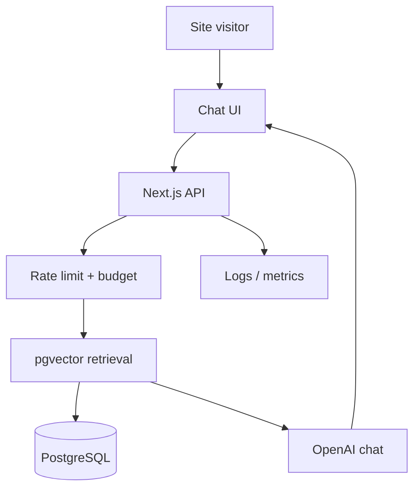

<Problem>

Most AI chatbot demos look fine in a Loom video. They break under **public traffic**, leak context, ignore **cost**, and answer confidently when they should not. Ask My Portfolio is the RAG assistant on this site—it must survive real visitors asking sharp questions about my projects and stack.

</Problem>

<WhatWouldHaveBroken>

- **Naive RAG**—whole-site paste into the prompt on every message.
- **No citations**—visitors cannot verify an answer against source content.
- **Unbounded OpenAI usage**—one bot scrape exhausts the monthly budget.
- **No rate limits**—easy to abuse anonymous endpoints.
- **Prompt injection** via uploaded or indexed content with no mitigation layer.
- **Blind operations**—no logs to debug bad answers or cost spikes.

</WhatWouldHaveBroken>

<Approach>

Production-minded RAG, not a weekend embed:

1. **Ingestion and chunking** — Portfolio content split into chunks with metadata for retrieval and updates when MDX changes.
2. **pgvector retrieval** — Embeddings stored in PostgreSQL; queries scoped to site content only.
3. **Grounded answers with citations** — Responses tie back to source chunks; low-confidence paths defer instead of hallucinating.
4. **Rate limiting** — Per-IP and global throttles on chat routes.
5. **Daily budget kill-switch** — Hard stop when estimated spend hits the configured daily cap.
6. **Caching** — Safe cache keys for repeated questions where freshness allows.
7. **Prompt-injection mitigation** — System prompts and retrieval boundaries that treat untrusted text as data, not instructions.
8. **Observability** — Structured logs and hooks for latency and cost attribution per request.

{/* TODO: Link to exact GitHub repository path once the RAG service repo is public. */}

</Approach>

<Architecture>

See the live walkthrough on the [demo page](/demo).

</Architecture>

<Results>

Use the **How this is built** panel on [/demo](/demo) for architecture notes and operational detail as the widget ships.

Live stats (from the database when available):

- **Avg latency:** TODO: add metric
- **Avg cost per query:** TODO: add metric

{/* TODO: Wire Results to live stats API once telemetry is in production. */}

- [Try the demo](/demo)
- [GitHub](https://github.com/aliyasmuhammad12) {/* TODO: Replace with portfolio/RAG repo URL when published. */}

</Results>

<TechStack>

- Next.js App Router (this site)
- OpenAI embeddings and chat completions
- PostgreSQL + pgvector
- Rate limiting, caching, and budget guards on API routes

</TechStack>

<CTA />
