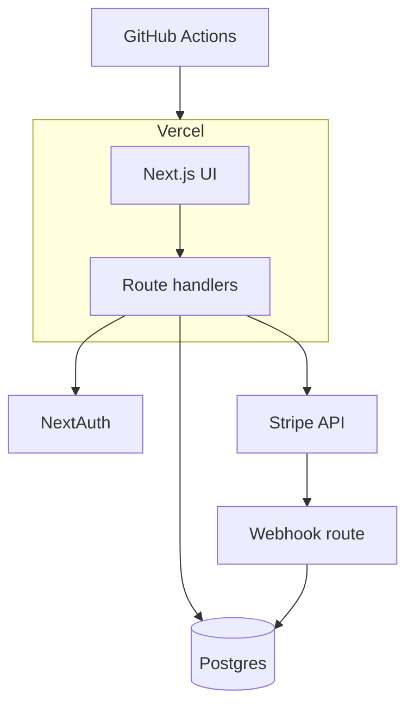

<Problem>

Founders had a compelling Lovable/v0 prototype: polished UI, fake data, no accounts, payments mocked in state. They needed to **charge customers** and pass a basic security review before a design-partner launch.

{/* TODO: Replace example.com clientUrl with real product URL when public. */}

</Problem>

<WhatWouldHaveBroken>

- Shipping the generated API routes as-is (no validation, secrets in client bundles).
- Stripe Checkout without webhooks—paid users stuck in "free" tier.
- Single `.env` shared over Slack; no preview vs production separation.
- Skipping CI—every hotfix bypasses typecheck until something breaks in prod.

</WhatWouldHaveBroken>

<Approach>

1. **Audit the prototype** — Inventory screens, delete dead components, map data models to Prisma schema.
2. **Auth** — NextAuth with Google + email magic links; middleware protecting `/app/*`.
3. **Billing** — Stripe Checkout + Customer Portal; webhook handler idempotent with event log table.
4. **Pipeline** — GitHub Actions running typecheck, lint, tests; Vercel previews per PR.

```typescript
// Webhook idempotency sketch
export async function POST(req: Request) {
  const event = stripe.webhooks.constructEvent(body, sig, secret);
  const existing = await db.stripeEvent.findUnique({ where: { id: event.id } });
  if (existing) return new Response("ok", { status: 200 });
  await handleStripeEvent(event);
  await db.stripeEvent.create({ data: { id: event.id, type: event.type } });
  return new Response("ok", { status: 200 });
}
```

</Approach>

<Architecture>



</Architecture>

<Results>

The team kept the prototype's UX while gaining real accounts, subscriptions, and deploy confidence.

{/* TODO: Add launch checklist completion date and founder quote. */}

</Results>

<TechStack>

- Next.js 15 App Router, strict TypeScript
- Prisma + Postgres (Neon)
- NextAuth, Stripe, Resend for transactional email
- Playwright smoke tests on checkout path (TODO expand coverage)

</TechStack>

<Testimonial
  quote="TODO: Founder quote about speed vs production readiness."
  author="TODO"
  role="Co-founder"
/>

<CTA />
