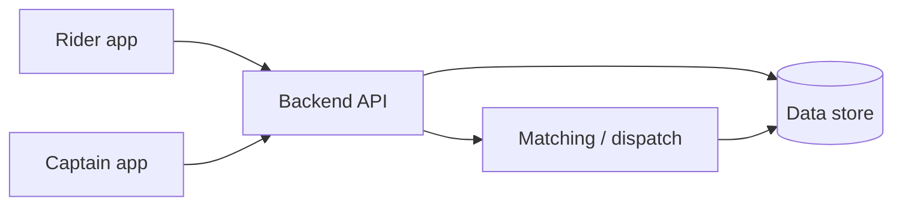

<Problem>

**Built in Gilgit, for the roads we grew up on.**

Ride-hailing apps in Pakistan are designed around the plains. They do not handle roads that climb ~3,000 m in an afternoon, patchy connectivity, or mountain routing on the Karakoram Highway. North Travena exists for captains and riders who live on those routes—not as a demo on flat maps.

</Problem>

<WhatWouldHaveBroken>

- **Plain-city dispatch** assuming always-on GPS and fast API round-trips—useless when connectivity drops mid-valley.
- **Captain onboarding** copied from urban apps, with no workflow for local verification and fleet realities in Gilgit-Baltistan.
- **A brittle data model** that cannot evolve as matching rules, zones, and ride states grow.
- **Auth and session handling** that fails silently when devices reconnect after dead zones.
- **No operational mindset** for reliability: retries, idempotency, and visibility when rides stall in production.

</WhatWouldHaveBroken>

<Approach>

My work focused on the **backend** and the systems that keep rides moving:

1. **Ride matching and dispatch** — Logic tuned for real mountain routes and captain availability, not generic nearest-car on a grid.
2. **Captain onboarding** — Flows for bringing captains onto the platform with data the operations team can trust.
3. **Data model** — Entities and relationships that support ride lifecycle, users, and future product changes without rewrites.
4. **Auth** — Session and access patterns that behave when the network does not.
5. **Reliability** — Defensive APIs, consistent error handling, and patterns that reduce double-bookings and orphaned ride states.

{/* TODO: Document exact stack (languages, frameworks, databases, queues). */}
{/* TODO: Explain how low-connectivity is handled (offline queues, retries, SMS fallbacks, etc.). */}
{/* TODO: Document payments integration and reconciliation if applicable. */}
{/* TODO: Add any verified performance numbers (p95 API latency, uptime, ride completion rate). */}

</Approach>

<Architecture>

{/* TODO: Add architecture diagram once stack and infra details are confirmed for public sharing. */}

High-level only—details intentionally omitted until documented with the team.

</Architecture>

<Results>

North Travena is live on the Karakoram Highway corridor with **100+ captains** and **500+ riders** on the platform.

{/* TODO: add metric — ride completion rate, monthly active riders, or other verified KPIs. */}
{/* TODO: add metric — uptime or incident counts if approved for publication. */}

Try the product: [northtravena.com](https://northtravena.com)

</Results>

<TechStack>

{/* TODO: List confirmed production stack (API framework, DB, mobile clients, hosting). */}

- Backend and APIs (primary focus area)
- Auth and user/captain identity
- Ride matching, dispatch, and core data model

</TechStack>

<CTA />
