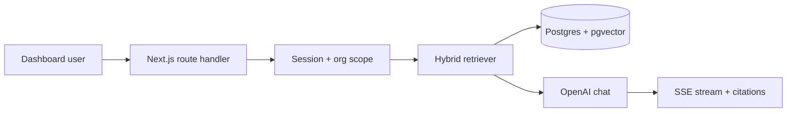

<Problem>

A B2B SaaS team had a working dashboard but support volume scaled faster than headcount. They wanted an in-app assistant that could answer **how-to** questions from their docs and release notes—not a generic ChatGPT iframe.

{/* TODO: Replace with real client name, industry, and ARR band once approved. */}

Constraints: multi-tenant data, SOC2-friendly logging, and answers that cite sources so CS could trust the bot.

</Problem>

<WhatWouldHaveBroken>

- Dumping all help center HTML into one giant prompt on every message.
- Letting any logged-in user query another tenant's uploaded files.
- Streaming tokens with no rate limits—one power user could exhaust the monthly budget in an afternoon.
- Shipping without evals: marketing copy says "AI support" but answers hallucinate on billing questions.

</WhatWouldHaveBroken>

<Approach>

1. **Ingestion pipeline** — Markdown/HTML docs chunked with overlap, embedded into Postgres (`pgvector`), versioned per doc publish.
2. **Retrieval** — Hybrid search (keyword + vector) scoped by `organizationId` from the session.
3. **Generation** — Small model for routing, larger model only when confidence is low; strict system prompt with "say I don't know."
4. **Product UX** — Streaming UI, citation chips linking to doc anchors, thumbs feedback stored for eval loops.

{/* TODO: Add sequence diagram export and link to internal runbook. */}

</Approach>

<Architecture>

</Architecture>

<Results>

Pilot cohort saw fewer repetitive tickets on configured topics. CS leads could audit answers via citation links instead of reading raw chat logs.

{/* TODO: Insert verified before/after metrics and screenshot of admin analytics. */}

</Results>

<TechStack>

- **App:** Next.js App Router, server actions for feedback events
- **Data:** PostgreSQL, Prisma, row-level org filters on every query
- **AI:** OpenAI embeddings + chat, LangChain for retrieval orchestration
- **Ops:** Vercel preview envs, structured logs with request IDs

</TechStack>

<Testimonial
  quote="TODO: Client quote about trust, citations, or support load once approved."
  author="TODO Name"
  role="TODO Title"
/>

<CTA />
